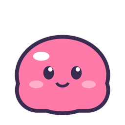

# Slime Push

A slime-themed take on the two-player **Push** mode from the DS block game, made for Steam Deck,
with a Windows build that plays against it. Native C++ / SDL2, no browser.
Any mix of Steam Decks and Windows PCs on the same network find each other automatically.



## Download

Grab the latest files from the [Releases page](https://github.com/shrieeiee/Slime-push/releases):

- `SlimePush-linux-steamdeck.tar.gz` for Steam Deck (or any x86_64 Linux)
- `SlimePush-windows.zip` for Windows 10/11 (64-bit)

## The rules

- Both players share one tall jar (10 wide, 38 tall). Two starter slimes sit in the middle.
- Your slimes drop down from your end; your opponent's rise up from theirs. On each screen,
  you always see your own slimes falling from the top.
- Fill a row to splat it. Clear **2 or more rows at once** and the whole pile shoves toward your
  opponent: double +1 row, triple +2, quad +4. The yellow wavy line shows where the middle is now.
- A player loses when slime is pushed off their end, or they stack into their own end.
- Drop a slime down a column with nothing in it and it plops out the far end and is gone.
  A pink marker at the far end warns you when that is about to happen.
- Speed goes up every 30 seconds.

## Controls

| Button | Action |
|---|---|
| D-pad / left stick | Move |
| Down | Soft drop |
| Up | Hard drop |
| A | Spin right |
| B or X | Spin left |
| Y, L1/R1, L2/R2 | Hold |
| Start | Pause (local) / forfeit (LAN) |

Keyboard: arrows, X/Z spin, C hold, Space hard drop, Enter, Esc. F11 toggles fullscreen.

## Install on Steam Deck

1. Switch to **Desktop Mode** (Steam button > Power > Switch to Desktop).
2. Download `SlimePush-linux-steamdeck.tar.gz` on the Deck and extract it, for example into `~/Games/`.
   You should end up with `~/Games/SlimePush/SlimePush`.
3. Open **Steam** in desktop mode > **Games** > **Add a Non-Steam Game to My Library** >
   **Browse**, pick `~/Games/SlimePush/SlimePush`, then **Add Selected Programs**.
   (If it isn't listed, right-click the file > Properties > Permissions > tick "Is executable".)
4. Go back to **Gaming Mode**. Slime Push is in Library > Non-Steam.
   The default gamepad layout works as-is.

## Install on Windows

1. Extract `SlimePush-windows.zip` anywhere and run `SlimePush.exe`. It's one file, nothing to install.
2. The exe isn't code-signed, so Windows SmartScreen may warn the first time:
   click **More info** > **Run anyway**.
3. When **Windows Firewall** asks, tick **Private networks** and click **Allow access**.
   Without this the other player can't see you.

An Xbox / PlayStation / Switch Pro controller works, or use the keyboard.
It starts fullscreen; F11 switches to a window.

## Playing over LAN

Decks and Windows PCs can play each other in any combination.

1. Put both machines on the **same network** (Wi-Fi or wired, same router).
2. On one pick **LAN BATTLE: HOST**.
3. On the other pick **LAN BATTLE: JOIN**. The host shows up on its own within a second; press A.
4. After a match, both press A for a rematch.

The game uses UDP ports **47790** (discovery broadcast) and **47791** (game). SteamOS has no firewall
by default, so nothing needs opening there.

**If a Windows PC can't see or be seen:** Windows blocks LAN games on networks marked **Public**.
Open Settings > Network & internet > (your Wi-Fi or Ethernet) and set the network profile to
**Private**, then check the firewall rule: Windows Security > Firewall & network protection >
Allow an app through firewall > Slime Push, with **Private** ticked.

**If the other Deck never appears:** some routers block devices from seeing each other
(often called "AP isolation" or "client isolation", and usually switched on for guest networks).
Use your main network, or turn on a phone hotspot and connect both Decks to it.
You can also skip discovery and join by address (shown on the host's waiting screen):
on a Deck set Steam's **Launch Options** for Slime Push to `--join 192.168.1.23`; on Windows make a
shortcut to `SlimePush.exe --join 192.168.1.23`.

## Music

Three original bouncy chiptunes are built in, synthesized by the game itself, so there are no files to ship:
**Bloop Bounce** plays on the menus, and **Jelly Jam** and **Wobble Rush** take turns in matches.
The battle tune speeds up a little each time the level goes up. Music and sound effects can be switched
off separately in Settings.

**Add your own tracks:** drop `.ogg`, `.mp3` or `.wav` files into a `music` folder next to the game
(`~/Games/SlimePush/music/` on a Deck, next to `SlimePush.exe` on Windows), or into
`~/.config/slimepush/music/` / `%APPDATA%\SlimePush\music\`. Files whose names start with `title` or `menu`
play on the menus; everything else joins the match rotation. Seamless loops work best.
Two free packs that suit the game:

- [NOT JAM Music Pack 2](https://not-jam.itch.io/not-jam-music-pack-2): 15 Game Boy / NES style tracks, CC0, loopable OGG/WAV
- [Buzzy Bits](https://dylanntaylor.itch.io/buzzy-bits): 6 bright, upbeat 8-bit loops, free including commercial use

## Other modes

- **VS CPU**: Easy / Normal / Hard (change in Settings). The CPU plays at human speed: it pauses to
  think, taps pieces across, and sometimes fumbles.
  - **Easy** is slow and wobbly, never slams pieces down, and grabs any single-row clear it sees.
  - **Normal** plays steadily and saves up for doubles and triples to push you.
  - **Hard** is quick and sharp, sets up big pushes, but still moves at a person's speed.
- **2 PLAYERS (2 PADS)**: two controllers on one Deck. Player 2's slimes rise from the bottom,
  so for them Up is soft drop and Down is hard drop.

Settings (theme, music, sound effects, CPU level) are saved in `~/.config/slimepush/settings.txt` on Linux and
`%APPDATA%\SlimePush\settings.txt` on Windows.

## Building from source

Release builds are made by GitHub Actions (`.github/workflows/build.yml`) on every push;
pushing a `v*` tag attaches them to a release. To build them yourself on Linux:

```sh
./tools/build-linux.sh     # -> dist/SlimePush-linux-steamdeck.tar.gz  (static SDL2, glibc 2.29+)
./tools/build-windows.sh   # -> dist/SlimePush-windows.zip             (MinGW cross-compile, one .exe)
./build.sh                 # quick build against your system SDL2 -> build/SlimePush
```

The scripts download SDL 2.30.9 themselves. The Linux one compiles with zig (installed through pip)
so the binary runs on older glibc; see the workflow for the apt packages it needs.

Command line options: `--windowed`, `--host`, `--join <ip>`, `--cpu`, `--dark`, `--light`.

## Code layout

- `src/game.cpp` Push-mode rules (shared field, opposite gravity, SRS spins, push, win/loss) and the CPU.
- `src/net.cpp` UDP broadcast discovery, packets and the small Linux/Windows platform layer.
  The host runs the game and streams the state to the other player 60 times a second;
  the joiner sends its button presses.
- `src/gfx.cpp` Drawing: anti-aliased shapes, outlined TrueType text (stb_truetype), the Pocket Bloop slime.
- `src/audio.cpp` Synthesized sound effects and the looping, crossfading music player.
- `src/music.cpp` The built-in tunes (written as note strings and rendered by a small chip synth:
  pulse lead with echo, arpeggios, stepped-triangle bass, noise drums) and the OGG/MP3/WAV loader.
- `src/main.cpp` Menus, input, rendering of the jar, effects.

## Credits

- Fonts: [Mochiy Pop One](https://fonts.google.com/specimen/Mochiy+Pop+One) and
  [M PLUS Rounded 1c](https://fonts.google.com/specimen/M+PLUS+Rounded+1c), both under the SIL Open Font License 1.1,
  embedded in `src/fonts_data.h`.
- [stb_truetype and stb_vorbis](https://github.com/nothings/stb) by Sean Barrett (public domain).
- [dr_mp3 and dr_wav](https://github.com/mackron/dr_libs) by David Reid (public domain / MIT-0).
- Music: original compositions for this game.
- [SDL2](https://libsdl.org) (zlib license).
